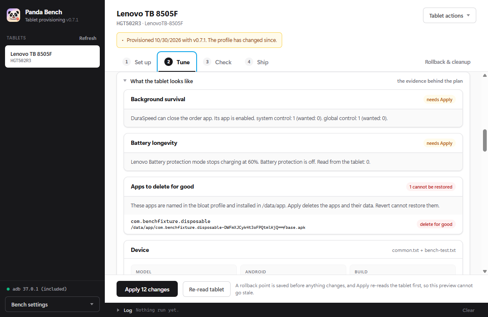
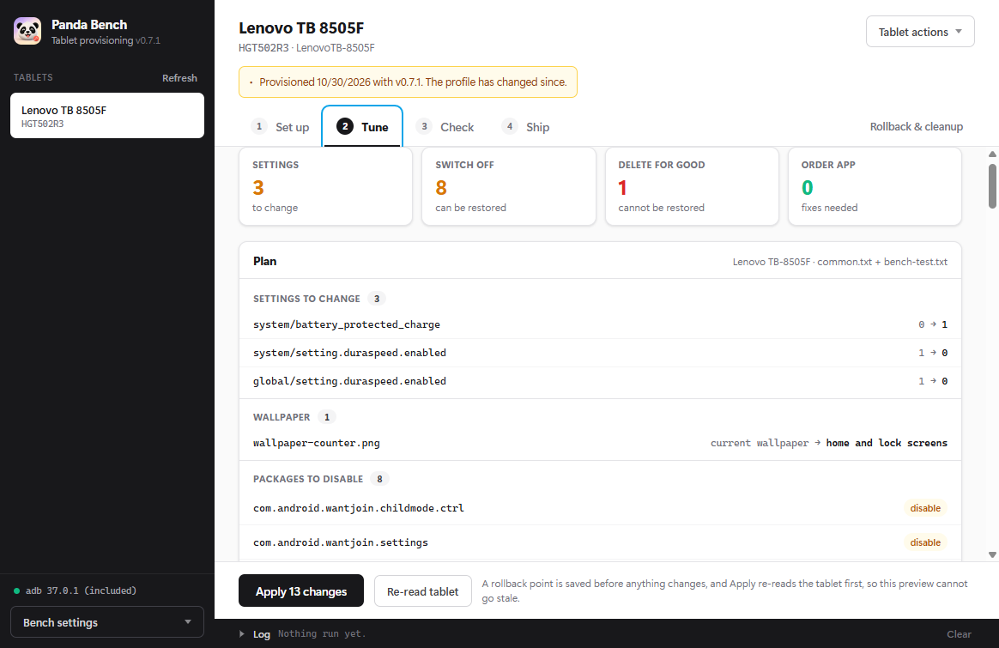
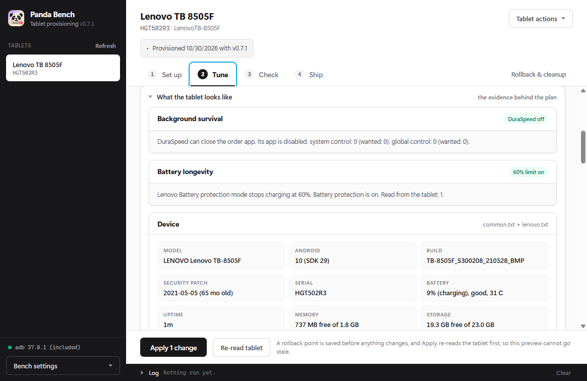

# Lenovo Tab M8 HD check, October 30, 2026

Device: HGT502R3, Lenovo TB-8505F, Android 10 / SDK 29,
build TB-8505F_S300208_210528_BMP. All adb processes ran from D:\tmp.
No root, factory reset, version bump, or release was used.

The final Apply run set three controls, switched off eight system packages, deleted one disposable
test app, and set both wallpapers. Every action was read back. The app was tested through its real
Electron renderer and IPC handlers. The screenshots below are captures of that renderer and the
tablet, not mockups.

## Battery protection

Opened Settings > Battery and switched Battery protection mode off, then on. Compared the full
system, secure and global settings lists after each tap:

| Control | Off | On |
| --- | --- | --- |
| system battery_protected_charge | 0 | 1 |
| global protect_battery | 1 | 1 |
| Other system, secure or global differences from these taps | None | None |

The tablet's explanation says charging stops at 60%. Apply was then tested from 0 to 1, and the
Settings switch read ON afterward. It remained 1 after reboot. This verifies the actual toggle,
not a charging cycle from empty to 60%.

## DuraSpeed

Inspected the installed DuraSpeed APK and the tablet's framework jar. The app's getDuraSpeedStatus
reads system setting.duraspeed.enabled. Its setDuraSpeedStatus writes both system and global.
The framework service observes the global key and reads the system key on user switch.

| File on this tablet | SHA-256 |
| --- | --- |
| /system/product/priv-app/DuraSpeed/DuraSpeed.apk | 4ccbcc1c3eeb32cb30290a782871ba204502936b2f796c36375c08758d3fef15 |
| /system/framework/duraspeed.jar | f7635351dc353da94a88bb21925230276d74a977a14babc36bf826516e508b65 |

Enabled the package and set both controls to 1 for the test. The audit found all three.
Apply disabled the package and wrote both controls to 0. All three stayed off after reboot.

## Package actions

These seven requested packages were still installed but disabled. Each was enabled with pm enable,
found by the audit, and disabled again by Apply. Each remained disabled after reboot:

- com.motorola.demo
- com.tblenovo.whatsnewclient
- com.android.wantjoin.settings
- com.android.wantjoin.childmode.ctrl
- com.lmsa.app.lmsapad
- com.verizon.remoteSimlock
- com.dolby.daxappui

Their paths were under /system. DuraSpeed was the eighth disabled system package.
com.dolby.daxservice remained installed and enabled. The order app was not replaced or removed.

The requested games, news apps, Digital Turbine, Grubhub packages and SureLock were already absent.
They were not reinstalled. Unit tests cover their profile entries and the plain English audit notes.

Built and sideloaded the no-code APK from [the disposable fixture](../../test/fixtures/disposable/AndroidManifest.xml).
Its package was com.benchfixture.disposable, and pm path placed it in /data/app. A temporary
bench-test.txt profile contained the Lenovo entries plus [the test package](../../test/fixtures/disposable/bloat.txt).
The real profile loader was used for that file. It was removed before the final audit and is not shipped.
The audit and Apply plan listed the fixture under Delete for good. Apply ran pm uninstall, then
confirmed it was absent from the installed package list. It stayed absent after reboot. Its
rollback entry records a permanent deletion and never offers to re-enable it.

The first uninstall test also found updated system apps in /data/app: Duo, Digital Wellbeing,
YouTube Music, TalkBack and Google TV. Android returned Success after removing the updates but
left the original system copies. Bench reported those deletions as unconfirmed. The next audit
found the copies under /system, and the next Apply disabled them and read them back. This is why
uninstall output alone is never accepted as proof that an app is gone.

## Wallpaper

Counter, dark, light and a custom JPEG all set home and lock without a tap. The helper was disabled
after each use. The normal permission SET_WALLPAPER performed the writes. Previous images were
saved before replacement, and Revert restored both a shared home/lock image and separate images.
The cold-helper transfer test exposed an adb race; the final code waits for exact uploaded bytes
before using an image. Restoration then passed on the tablet.

The custom JPEG was 463 by 401 pixels and contained a circle. The saved result was 800 by 1280;
the circle measured 638 by 638 pixels, a 1:1 ratio. The image was center-cropped, not stretched.

The final Apply returned home ID 19 and lock ID 20. dumpsys wallpaper reported the same IDs,
and both survived reboot. The parser also has a fixture for the
[Android 14 dump format](https://github.com/aosp-mirror/platform_frameworks_base/blob/android-14.0.0_r1/services/core/java/com/android/server/wallpaper/WallpaperManagerService.java).

For the fallback test, the bundled helper APK was temporarily unavailable and then restored.
Bench opened Lenovo's wallpaper cropper, returned ok=false and pending=true, and left wallpaper
IDs 17 and 18 unchanged. Android 10 needed the media scanner broadcast after its scan_file call
failed. No tap was made to set the fallback image.

Physical testing covers Android 10. The helper uses APIs available on Android 10 through 14,
including temporary storage access for backup on newer versions, but Android 11 through 14
have not been physically tested in this work.

## Final state and tests

pnpm test passed all 63 tests. The suite covers install paths, profile and runtime guards,
permanent deletion readback, irreversible rollback wording, Lenovo controls, DuraSpeed on other
brands, wallpaper IDs, pending fallback, backup ordering, cleanup, and delayed binary transfers.

An unpacked Windows build also passed with publishing disabled. Its wallpaper-helper.apk hash
matches the APK tested on the tablet, and its resources include all three settings profiles.

[The final readback](HGT502R3-readback.json) confirms all new controls after reboot. It also records
one other profile setting, global app_standby_enabled, returning to 1 after boot. The audit shows
that remaining change. This is not a claim that the whole tablet is ready for a restaurant, or
that the order listener was tested against a live order or printer.

Before Apply, including the disposable app's permanent-deletion warning:

The Apply plan separates switching off from deleting for good, and includes the wallpaper:

After reboot, showing DuraSpeed off and Lenovo's 60% control on:

The actual tablet home screen after reboot:

