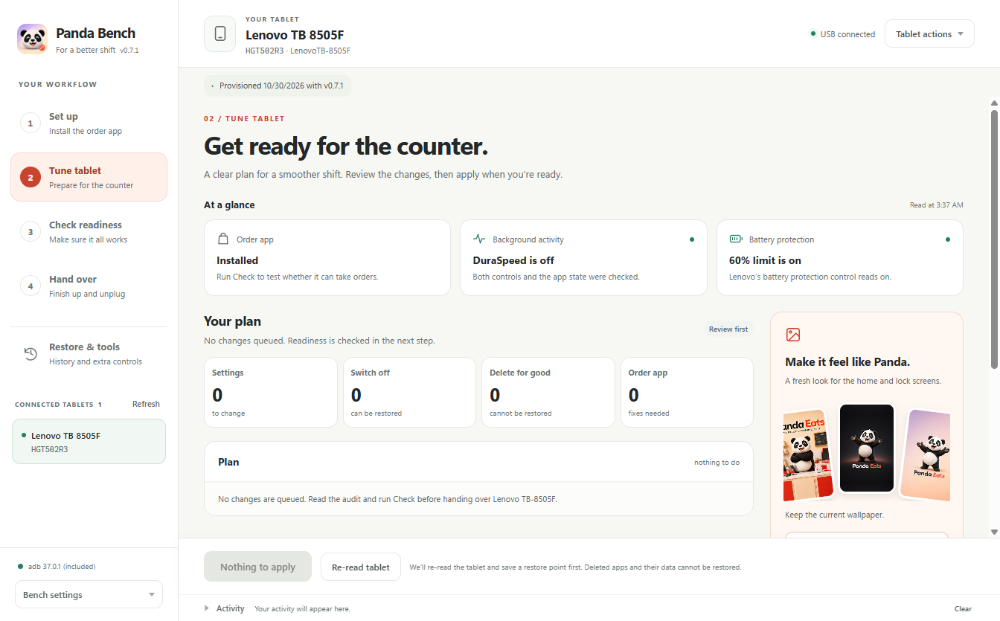
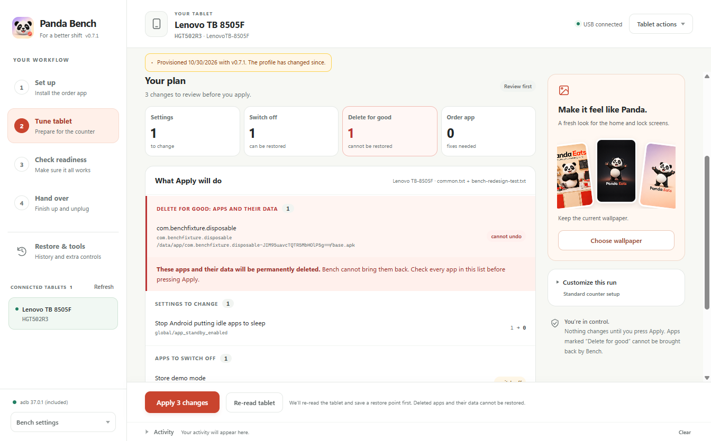
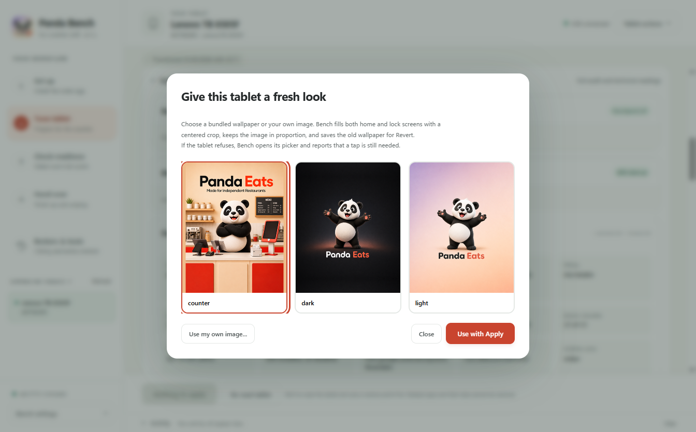
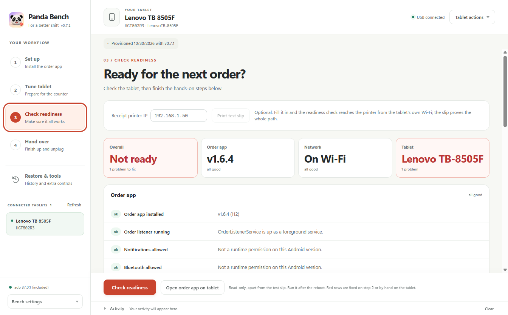
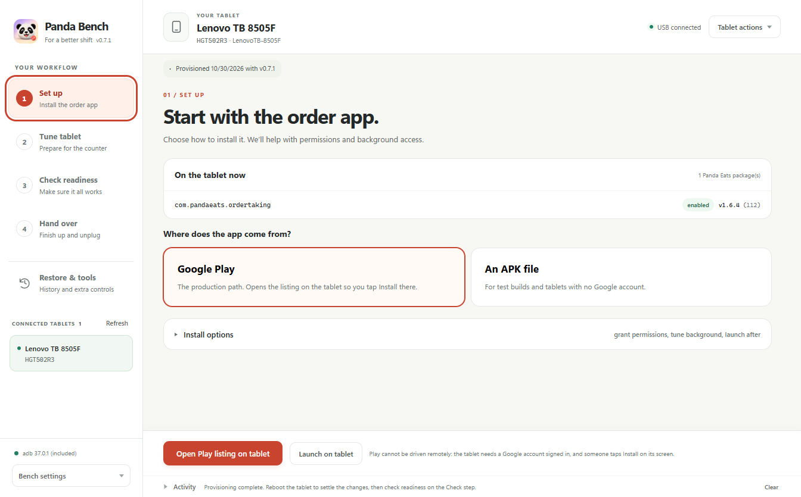
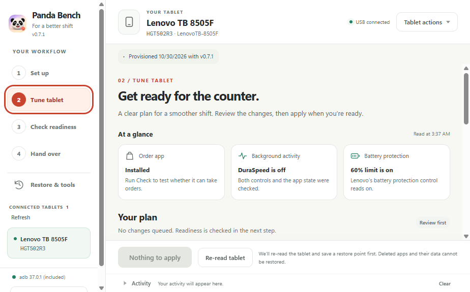
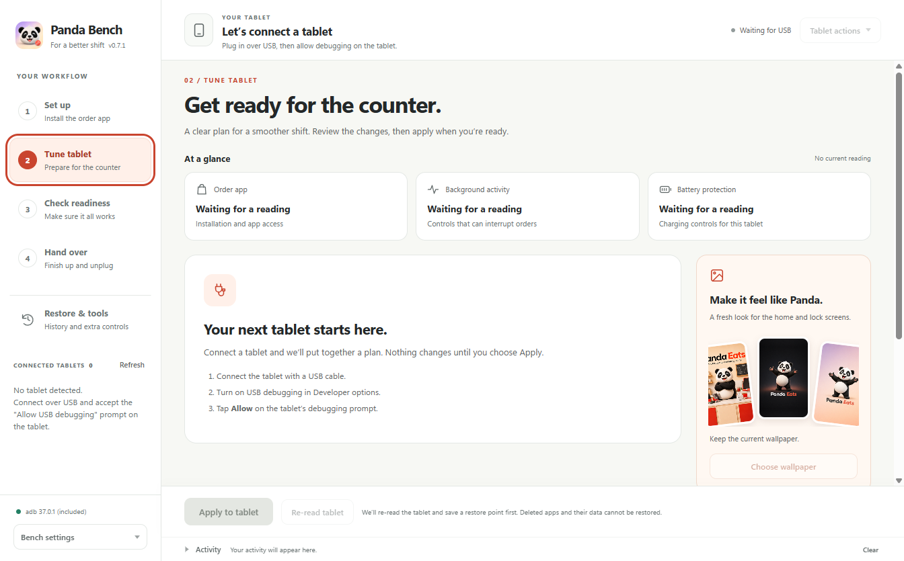

# Panda Bench workspace redesign

The light Panda Eats workspace was checked on October 30, 2026 with the real Lenovo
TB-8505F, Android 10, serial HGT502R3. The screenshots below show the running Electron
renderer. Device screens use live USB readings. The disconnected screen was tested by
returning an empty device list to the renderer, without changing the tablet.

## What changed

- A light workspace, coral actions, a vertical workflow and clearer page titles.
- An at-a-glance summary separates an installed order app from readiness to take orders.
  Missing readings and unsupported controls never receive a confirmed status.
- The plan explains settings in plain English, with exact keys available underneath.
  Permanent app deletions appear first in their own warning panel. Switching off stays separate.
- Wallpaper previews, a simpler chooser and one action per entry point: Use with Apply,
  or Send to tablet from Tablet actions. Queuing a wallpaper does not change the tablet.
- Clearer setup, readiness, handover, restore, loading, disconnected and error screens.
- A fixed action bar, keyboard navigation, reduced-motion support and a compact layout.

## Checks

All 69 tests passed with `pnpm test`, including six new presentation tests covering unknown
readings, production versus test apps, DuraSpeed confirmation, battery protection and labels.
An unpacked Windows build passed with publishing disabled. Version remains 0.7.1.

The real renderer and IPC handlers were exercised at 1360 by 900 and at the minimum 940 by 640
window size. Checked all five workflow screens, arrow-key navigation, the tablet menu and
Escape, wallpaper queue and clear, both wallpaper entry points, and the apps skip option.
The compact layout keeps the main actions reachable and the wallpaper dialog's Close button
visible. No renderer errors or broken images were found.

To test the deletion warning and Apply, the existing disposable APK was sideloaded again and
named in a temporary test profile. Store demo mode was enabled again with `pm enable`.
The new audit showed one permanent deletion and one app to switch off in separate groups.
Choosing Leave apps alone removed both actions; switching it back restored both.

Apply then ran through the new screen. Readbacks confirmed:

| Action | Result |
| --- | --- |
| Delete com.benchfixture.disposable | Absent from installed packages |
| Switch off com.motorola.demo | Present in disabled packages |
| Set counter wallpaper | Home ID 21, lock ID 22 in dumpsys wallpaper |
| Lenovo battery protection | system battery_protected_charge = 1 |
| DuraSpeed | Both system and global setting.duraspeed.enabled = 0 |

The temporary profile was removed, the standard profile was read again, and its provisioning
record was refreshed. The disposable APK remains absent. All adb commands ran from D:\tmp.

Disconnect and read-error tests confirmed that old green status summaries disappear.
The readiness screen still reports the tablet's swipe lock as a problem. No printer was
configured for this run, no live test order was placed, and the handover checklist was not
marked complete. This redesign does not claim the tablet is ready for a restaurant.
The earlier [device validation record](HGT502R3-2026-10-30.md) still documents the reboot
behavior and Android-version limits.

[Recorded checks and readbacks](bench-redesign-readback.json)

## Screenshots

Tune tablet, after the real Apply run:

The real disposable app, clearly separated for permanent deletion:

Wallpaper chooser:

Readiness, with the outstanding problem still visible:

Setup:

Compact window:

Disconnected state, simulated by an empty device list:

